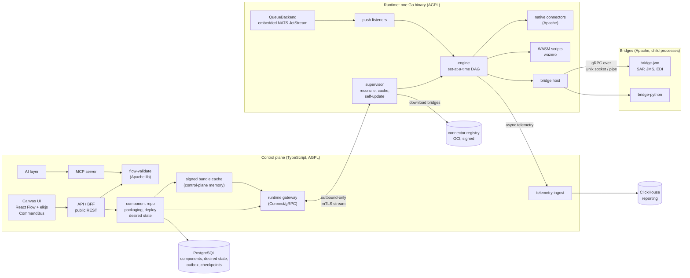
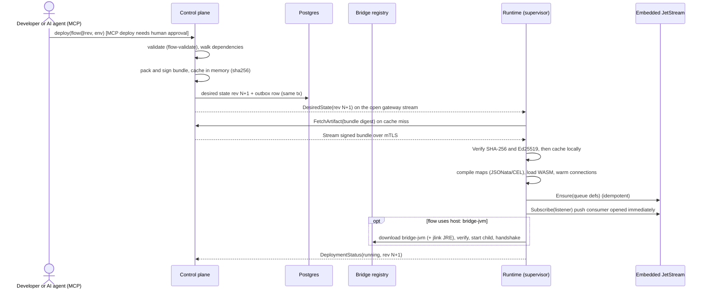
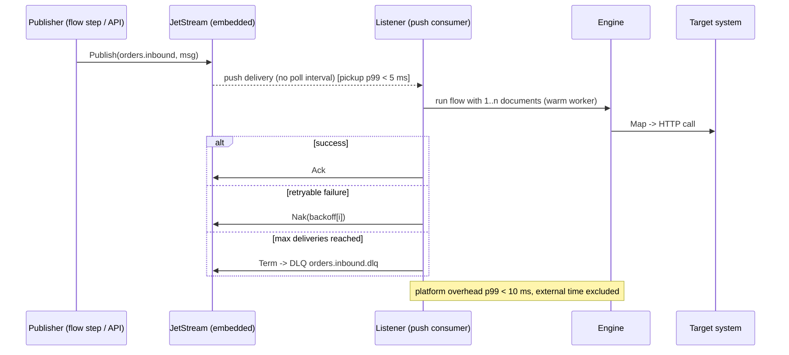

# Nurtuo: Repository and Project Architecture

Status: proposal, 2026-11-21. Source of truth for product and technology decisions:
`boomi-architecture-reference.md` (Technology decisions, License audit, Part I §10.1–10.5,
Part II §5.6, Part V). This document turns those decisions into a repository layout, build,
CI and a first backlog. The skeleton described here exists in `repo/` and builds.

Names used below: GitHub org `nurtuo`, main repository `nurtuo/nurtuo`, runtime binary
`nurtuo` (the reference document's `ipaas`), control-plane executable `nurtuo-control-plane`,
developer CLI `nurtuoctl`.

---

## 1. Decision: one monorepo, split by license at the top level

**Recommendation: a single monorepo `nurtuo/nurtuo`**, with AGPL-3.0 code under `core/` and
Apache-2.0 code in separate top-level directories (`proto/`, `sdk/`, `connectors/`, `bridges/`,
`cli/`, `examples/`, `docs/`), each with its own `LICENSE`. Two small satellite repos are added
when needed: `nurtuo/.github` (org profile and default community files) and later
`nurtuo/website` / `nurtuo/docs-site`.

Why a monorepo:

1. **One contract, many languages.** A change to the connector contract touches `proto/`, the Go
   runtime, the Go connector SDK, the TS control plane and later the JVM bridge. A change to the
   flow schema touches the TS validator, the canvas, the MCP server and the Go engine. In one repo
   that is one PR, one CI run and one review; across repos it is a release dance with version skew.
2. **The shared validation library is the product's core promise** ("the canvas and the AI agent
   validate identically"). Keeping it next to its consumers prevents silent drift.
3. **Small team (8–10 for M1).** One issue tracker, one CI configuration, one release train.
   Grafana (AGPL core + Apache libraries in one repo) and Kestra both work this way.
4. **License boundaries are enforceable in a monorepo** with directory `LICENSE` files, SPDX
   headers, separate Go modules / npm packages and a CI boundary check (§7). The license is a
   property of the directory, not of the repository.

When to split something out (not now): a component that gets its own release cadence *and* an
outside community, for example a large community connector catalogue (`nurtuo/connectors-contrib`)
or the bridges once they have their own maintainers. Because Apache code never imports `core/`,
any Apache directory can be moved to its own repo with `git filter-repo` without refactoring.

Rejected alternatives:

| Option | Why not |
|---|---|
| Two repos (`nurtuo` AGPL + `nurtuo-sdk` Apache) | Every contract change becomes a cross-repo release; the validator drifts from the canvas |
| Repo per component (runtime, control plane, canvas, sdk, bridges…) | Too much coordination for a small team; version matrix explodes before 1.0 |
| Monorepo without license split dirs | Mixing AGPL and Apache files in one directory makes audits and extraction impossible |

### License map

| Path | License | Contents |
|---|---|---|
| `/` root files, `core/**` | AGPL-3.0-only | Runtime/supervisor, control plane, MCP, AI layer, canvas UI, deploy packaging |
| `proto/**` | Apache-2.0 | gRPC contracts |
| `sdk/**` | Apache-2.0 | Go SDK (generated code + connector SDK), TS flow schema, flow validator, proto types, API client |
| `connectors/**` | Apache-2.0 | Native Go connectors |
| `bridges/**` | Apache-2.0 | JVM, Python, .NET connector hosts |
| `cli/**` | Apache-2.0 | `nurtuoctl` |
| `examples/**`, `docs/**` | Apache-2.0 | Example flows, documentation |

Rule: **AGPL may depend on Apache; Apache must never depend on AGPL.** The root `LICENSE` is the
AGPL text so GitHub shows AGPL for the repository; `LICENSING.md` explains the map and the FAQ.
Contributions need a CLA (CLA Assistant GitHub App). Customer-supplied proprietary libraries
(SAP JCo, IBM MQ client, Oracle/Db2/Teradata JDBC, Saxon PE/EE) are never in the repository or
in release artifacts.

---

## 2. Directory tree

```
nurtuo/                              # github.com/nurtuo/nurtuo
├── LICENSE                          # AGPL-3.0 (default for root and core/)
├── LICENSING.md                     # license map, CI rules, FAQ
├── README.md  CONTRIBUTING.md  CODE_OF_CONDUCT.md  SECURITY.md
├── go.work                          # Go workspace: core/runtime, sdk/go, connectors
├── package.json  pnpm-workspace.yaml  pnpm-lock.yaml  turbo.json  tsconfig.base.json
├── buf.yaml  buf.gen.yaml           # proto workspace + codegen (Go, TS)
├── Makefile  .mise.toml             # task entry points, pinned toolchain
├── .goreleaser.yaml                 # runtime binary release (signed, SBOM, deb/rpm)
├── .github/
│   ├── workflows/ci.yml             # go, ts, proto, licenses jobs
│   ├── licenses/agpl-allow.txt      # third-party licenses allowed in AGPL artifacts
│   ├── licenses/apache-allow.txt    # stricter list for Apache artifacts
│   ├── ISSUE_TEMPLATE/  PULL_REQUEST_TEMPLATE.md  dependabot.yml
├── scripts/check-boundaries.sh      # dependency direction + SPDX header check
│
├── core/                            # AGPL-3.0 ─────────────────────────────────────
│   ├── LICENSE
│   ├── runtime/                     # Go module github.com/nurtuo/nurtuo/core/runtime
│   │   ├── cmd/nurtuo/              # the single static binary (run, standalone, service, role)
│   │   ├── internal/supervisor/     # registration, desired-state reconcile, artifact cache, self-update
│   │   ├── internal/gateway/        # outbound-only client of RuntimeGatewayService (mTLS)
│   │   ├── internal/engine/         # set-at-a-time DAG interpreter, streamed documents, disk spill
│   │   ├── internal/queue/          # QueueBackend interface (+ natsjs/, later kafka/, postgres/)
│   │   ├── internal/listener/       # push listeners: queues, HTTP, AMQP, Kafka, MQTT, CDC
│   │   ├── internal/connhost/       # registry of native connectors, routing to native/bridged hosts
│   │   ├── internal/bridgehost/     # download, verify, start, health-check, restart bridges
│   │   ├── internal/mapping/        # maps compiled to JSONata/CEL
│   │   ├── internal/script/         # WASM sandbox (wazero + Extism ABI)
│   │   ├── internal/telemetry/      # async exec summaries, OTel spans, metrics
│   │   ├── internal/store/          # local state: bundles, checkpoints, spill files
│   │   ├── internal/service/        # Windows service / systemd / launchd (kardianos/service)
│   │   ├── internal/version/        # build metadata (ldflags)
│   │   └── test/bench/              # perf harness for the p99 targets
│   ├── control-plane/               # TS: API/BFF, component repo, packaging, deploy, gateway, ingest
│   ├── web/                         # TS: canvas (React, React Flow/xyflow, elkjs, CommandBus)
│   ├── mcp/                         # TS: MCP server tools
│   ├── ai/                          # TS: AI gateway, generation, mapping suggestions, evals
│   └── deploy/                      # systemd/windows/launchd templates, helm/, dev/compose.yaml
│
├── proto/                           # Apache-2.0 ───────────────────────────────────
│   └── nurtuo/
│       ├── connector/v1/connector.proto   # Describe/Browse/Execute/Test/Listen
│       └── runtime/v1/gateway.proto       # runtime <-> control plane stream
├── sdk/                             # Apache-2.0
│   ├── go/                          # Go module github.com/nurtuo/nurtuo/sdk/go
│   │   ├── gen/                     # generated protobuf + gRPC (committed)
│   │   └── connector/               # connector SDK: Connector interface, Serve()
│   └── ts/
│       ├── flow-schema/             # @nurtuo/flow-schema: JSON Schema + TS types + commands
│       ├── flow-validate/           # @nurtuo/flow-validate: shared validator
│       ├── proto/                   # @nurtuo/proto: generated protobuf-es types
│       └── client/                  # @nurtuo/client: public API client
├── connectors/                      # Apache-2.0, Go module github.com/nurtuo/nurtuo/connectors
│   ├── http/  sftp/  postgres/  nats/   # each: connector.yaml, schemas/, Go code, contract tests
├── bridges/                         # Apache-2.0
│   ├── jvm/                         # Gradle, grpc-java, jlink JRE (M3)
│   ├── python/                      # uv, grpcio (M3)
│   └── dotnet/                      # optional (M3)
├── cli/                             # Apache-2.0, @nurtuo/cli -> `nurtuoctl`
├── examples/flows/                  # Apache-2.0, e.g. get-employee.flow.json
└── docs/                            # Apache-2.0, architecture, ADRs (docs/adr/), license FAQ
```

---

## 3. Go module layout

```
go 1.27
use (
    ./core/runtime      // github.com/nurtuo/nurtuo/core/runtime   (AGPL, binary only)
    ./sdk/go            // github.com/nurtuo/nurtuo/sdk/go         (Apache, importable library)
    ./connectors        // github.com/nurtuo/nurtuo/connectors     (Apache, importable library)
)
```

- **Three modules, not one.** The module boundary is the license boundary: `sdk/go` and
  `connectors` cannot accidentally import `core/runtime` (and CI checks it anyway). Third parties
  can `go get github.com/nurtuo/nurtuo/sdk/go` without pulling AGPL code.
- Dependency direction: `core/runtime → connectors → sdk/go`. Each `go.mod` also carries a
  `replace` to the sibling path so `go mod tidy` works per module without publishing.
- Everything under `core/runtime/internal/` is private; the only public Go API is in `sdk/go`.
- Build all Go: `go build github.com/nurtuo/nurtuo/...` from the root (a plain `./...` does not
  span workspace modules), or `go build ./...` inside a module.
- Tags: platform releases `vX.Y.Z` (runtime); importable modules `sdk/go/vX.Y.Z` and
  `connectors/vX.Y.Z` (Go's sub-module tag convention).
- Key libraries (all permissive, per the license audit): `nats-server` + `nats.go`, `grpc-go`,
  `protobuf-go`, `wazero` / Extism Go SDK, `cel-go`, a Go JSONata implementation,
  `kardianos/service`, `fergusstrange/embedded-postgres`, OpenTelemetry Go, `pgx`.

## 4. TypeScript workspace layout

**pnpm workspaces + Turborepo.**

- pnpm: strict `node_modules` (no phantom dependencies, which matters for the license scan),
  `workspace:*` links, fast and disk-efficient, first-class lockfile.
- Turborepo (MIT): task graph (`build` depends on `^build`), local and remote caching, simple
  config. Nx was considered; it is heavier than we need while Go builds stay in `make`/`go`.
- Bun compiles the control plane into one executable at release (`bun build --compile`); Node.js
  24 is the dev runtime and the fallback (Bun's ownership changed, see license audit).

| Package | Dir | License | Depends on |
|---|---|---|---|
| `@nurtuo/flow-schema` | sdk/ts/flow-schema | Apache | – |
| `@nurtuo/flow-validate` | sdk/ts/flow-validate | Apache | flow-schema |
| `@nurtuo/proto` | sdk/ts/proto | Apache | @bufbuild/protobuf |
| `@nurtuo/client` | sdk/ts/client | Apache | flow-schema |
| `@nurtuo/cli` (`nurtuoctl`) | cli | Apache | flow-schema, flow-validate, client |
| `@nurtuo/ai` | core/ai | AGPL (private) | flow-schema, flow-validate |
| `@nurtuo/mcp` | core/mcp | AGPL (private) | flow-schema, flow-validate |
| `@nurtuo/web` | core/web | AGPL (private) | flow-schema, flow-validate, client |
| `@nurtuo/control-plane` | core/control-plane | AGPL (private) | flow-*, proto, mcp, ai |

Planned stack inside: control plane on Fastify or Hono + Connect-ES (gRPC protocol for the
runtime gateway), Drizzle or Kysely on Postgres; canvas on Vite + React + `@xyflow/react` +
`elkjs` + Zustand; MCP via the official MCP TypeScript SDK; schema-driven forms (RJSF) from
`connector.yaml` JSON Schemas.

**Flow schema source of truth.** `sdk/ts/flow-schema/schema/flow.v1.schema.json` (JSON Schema
2020-12). TS types live next to it (later generated from it) and Go structs for the engine are
generated from the same file, so canvas, validator, MCP and runtime cannot disagree on the format.

## 5. Contracts: `proto/` and code generation

- buf v2 workspace (`buf.yaml`, module `proto/`), `buf lint` (STANDARD), `buf breaking` (FILE)
  against `main` on every PR, `buf format`.
- Packages are versioned in the path: `nurtuo.connector.v1`, `nurtuo.runtime.v1`. Breaking
  changes require a `v2` package; old versions stay until runtimes in the field have moved.
- `buf generate` (`make gen`):
  - Go: `protoc-gen-go` + `protoc-gen-go-grpc` → `sdk/go/gen/...` (managed `go_package_prefix`).
  - TS: `protoc-gen-es` v2 → `sdk/ts/proto/src/gen/...` (services included, used with Connect-ES).
  - Java/Python/.NET stubs are generated inside each bridge's own build from the same files.
- Generated code is **committed** so `go build` and `pnpm build` work without buf; CI regenerates
  and fails on a diff.
- `connector.proto` (draft in the skeleton) follows reference §5.6: `Describe`, `Browse`,
  `Execute` (bidi stream of chunks, per-document `SUCCESS | APPLICATION_ERROR | FAILURE`), `Test`,
  plus `Listen` for push listeners in bridges (JMS, IBM MQ). `gateway.proto` is the outbound-only
  runtime stream (hello, heartbeat, desired state, status, commands, artifact fetch).

---

## 6. Components and data flows

### 6.1 Component diagram



### 6.2 Deploy



### 6.3 Execute (one flow run)

1. Trigger: listener delivery, schedule, HTTP request, `run_now` command or test mode.
2. Engine builds the document set (streams, spill to disk above a threshold) and walks the DAG
   set-at-a-time; Branch paths run sequentially; per-document status is tracked.
3. Connector steps: native Go connector in process, or `Execute` stream to a bridge; results per
   document decide routing (Try/Catch, Decision).
4. Maps and conditions run as compiled JSONata/CEL; scripts run in wazero with limits.
5. No database call on the hot path. Execution summary, step spans and tracked fields go to an
   in-memory buffer and are shipped asynchronously (NATS → ingest → ClickHouse, or Postgres in
   standalone). Checkpoints only where the persistence level requires them.

### 6.4 Queue listener (hot path)



---

## 7. Build, release and CI

### 7.1 Release artifacts

| Artifact | Built by | Signed | Notes |
|---|---|---|---|
| `nurtuo` (6 targets: linux/windows/darwin × amd64/arm64) | goreleaser, `CGO_ENABLED=0`, `-trimpath` | cosign keyless (GitHub OIDC) + checksums | tar.gz/zip, deb/rpm (nfpm), MSI (WiX, separate job), macOS pkg (notarized) |
| `nurtuo-control-plane` (6 targets) | `bun build --compile`, UI assets embedded | cosign | released with the same version as `nurtuo` |
| `bridge-jvm` (with/without jlink JRE, per OS/arch) | Gradle + `jlink` | cosign, pushed as OCI artifact (`oras`) | own version, compatibility declared against `connector/v1` |
| `bridge-python`, `bridge-dotnet` | uv + python-build-standalone; `dotnet publish` | cosign, OCI | M3 |
| npm packages (Apache only: flow-schema, flow-validate, proto, client, cli) | changesets + `pnpm publish --provenance` | npm provenance | needs the `@nurtuo` npm org (deferred) |
| Container images (optional) | ko or Docker buildx | cosign | never required for install |
| SBOM | Syft (SPDX JSON) per artifact | attached to release | |

The runtime verifies deployment bundles with Ed25519 using its configured trusted keys.
Bridge release artifacts use cosign.

#### Snapshot dry-run

`make snapshot` runs `goreleaser release --snapshot --clean --skip=sign` and
writes artifacts to `dist/`. It builds the six `nurtuo` targets (`CGO_ENABLED=0`,
`-trimpath`), checksums, a Syft SPDX SBOM per archive, and deb/rpm packages.
Nothing is published. Needs GoReleaser v2 and Syft on `PATH` (see the README).

TODO (§7.1), left for the tagged release: cosign keyless signing (GitHub OIDC),
MSI via WiX, macOS pkg notarization, and `bun build --compile` of
`nurtuo-control-plane`. CI runs this dry-run from
`.github/workflows/release-snapshot.yml`.

### 7.2 CI (GitHub Actions, `.github/workflows/ci.yml`)

| Job | Steps |
|---|---|
| `go` | `go vet`, `go test -race` across the workspace, cross-compile the runtime for all 6 targets, golangci-lint |
| `ts` | `pnpm install --frozen-lockfile`, `turbo run lint typecheck build test` |
| `proto` | `buf lint`, `buf format`, `buf breaking` against `main` (PRs), stale-codegen check |
| `licenses` | `scripts/check-boundaries.sh` (Apache never imports `core/`, SPDX headers match the directory); `go-licenses check` against `agpl-allow.txt` (core) and `apache-allow.txt` (sdk/go, connectors); `license-checker` on production deps of each npm package against the matching list; Syft SBOM |
| `cla` | CLA Assistant GitHub App as a required status check |
| `bench` (nightly + `perf` label) | perf harness on a fixed runner, p50/p99 published; fail if p99 targets regress >10 % |
| `e2e` (from M1 epic 9) | standalone install on Linux and Windows runners, GetEmployee flow end to end |
| `release` (on tag `v*`) | goreleaser, bun compile job, signing, SBOMs, draft GitHub release |

Branch protection on `main`: required checks `go`, `ts`, `proto`, `licenses`, `cla`; one review;
linear history (squash merge).

---

## 8. Local development (one command)

```sh
make bootstrap   # mise install (pinned go, node, pnpm, buf, linters), pnpm install, go work sync
make dev         # Postgres (compose) + control plane + canvas (turbo dev) + runtime (go run)
```

- `.mise.toml` pins every tool version; mise is MIT and works on Linux, macOS and Windows.
- Docker is only a convenience for dev services. Once the standalone epic lands,
  `go run ./core/runtime/cmd/nurtuo standalone --dev` starts embedded Postgres and the control
  plane without Docker, matching the "no Docker required" promise.
- Optional profiles: `docker compose --profile reporting` (ClickHouse), `--profile storage` (SeaweedFS).
- `make gen` regenerates contracts; `make boundaries` runs the license boundary check locally.

## 9. Testing strategy

| Level | What | Where |
|---|---|---|
| Unit | Go `testing` (+ `-race`), Node test runner / Vitest | next to code |
| Contract | One shared suite for the connector contract, run against every native connector and every bridge (golden descriptors, per-document status semantics, streaming of large payloads, crash behaviour) | `sdk/go/connector/contracttest` (Apache, reusable by third parties) |
| Schema conformance | A corpus of valid/invalid flows in `examples/` and `sdk/ts/flow-schema/testdata`; TS validator and Go decoder must agree on every file | both CI jobs |
| Deterministic engine | Snapshot tests: flow + input documents → exact outputs and per-step statuses (set-at-a-time semantics make this reproducible) | `core/runtime/internal/engine` |
| Integration | Testcontainers or embedded services (Postgres, NATS, SFTP, mock HTTP) | `core/runtime`, `core/control-plane` |
| E2E | Standalone install → deploy GetEmployee via API and via MCP → call it → check reporting; canvas flows with Playwright | `test/e2e` (added in epic 9) |
| AI evals | Prompt → flow tasks scored on validity and dry-run success; run in CI on changes to `core/ai` | `core/ai/evals` |
| Performance | `core/runtime/test/bench`: pickup p99 < 5 ms, overhead p99 < 10 ms (queue → Map → mock HTTP); 1 GB file through Map with bounded memory; canvas 250 steps at 60 fps | nightly `bench` job |
| Chaos (M2+) | Control plane down 24 h; bridge killed mid-batch; leader loss (M4) | dedicated workflow |

## 10. Versioning and branches

- **SemVer.** One platform version for `nurtuo`, `nurtuo-control-plane` and the bundle format
  (`v0.x` until the M1 acceptance criteria pass, `v1.0.0` after). Runtime and control plane
  support N-1 minor versions against each other (runtimes in the field update later).
- **Independently versioned:** Go modules `sdk/go` and `connectors` (sub-module tags), npm
  packages (changesets), bridges, proto packages (`v1`, `v2` in the package path).
- **Flow format** carries `schema: nurtuo.flow/v1`; migrations are code in `flow-schema`.
- **Branches: trunk-based.** Short-lived feature branches off `main`, squash merge, Conventional
  Commits (drives changelogs). Release branches `release/vX.Y` are cut only for patch releases;
  fixes land on `main` first and are cherry-picked. Feature flags instead of long-lived branches.
- **ADRs** in `docs/adr/` for decisions that change contracts or licenses.

---

## 11. What to create first

1. **Repos:** `nurtuo/nurtuo` (public, from the skeleton) and `nurtuo/.github` (org profile
   README, default `SECURITY.md`/`CODE_OF_CONDUCT.md`). Nothing else yet.
2. **Org settings:** install the CLA Assistant app and link the CLA text (gist); enable private
   vulnerability reporting, Dependabot, secret scanning; branch protection on `main`; add a second
   org owner.
3. **Labels/milestones:** milestones `M1 Core product`, `M2 Team product`, `M3 Enterprise
   connectivity`, `M4 Platform scale`; labels `area/runtime`, `area/control-plane`, `area/canvas`,
   `area/mcp-ai`, `area/connectors`, `area/proto`, `area/infra`, `license`, `perf`.

### First epics (all milestone M1), in order

| # | Epic | Scope | Depends on |
|---|---|---|---|
| 1 | **Repo foundation and CI** | Skeleton, CI green, license scans with both allow-lists, boundary check, CLA, branch protection, release dry-run (`make snapshot`) | – |
| 2 | **Contracts v1** | Finalise `connector.proto` and `gateway.proto`, codegen Go/TS, contract-test suite skeleton | 1 |
| 3 | **Flow format and validator** | `flow.v1` JSON Schema complete for M1 steps, TS types and Go structs generated, CommandBus commands, validator rules from reference Part III §5, conformance corpus | 1 |
| 4 | **Engine core** | Set-at-a-time interpreter, documents as streams with disk spill, Start/Message/Set Properties/Decision/Branch/Route/Stop/Return, per-document status, Try/Catch, Process Call | 3 |
| 5 | **Queues and push listeners + perf harness** | `QueueBackend`, embedded JetStream `natsjs`, queue component (retention, retries, DLQ, ordering, concurrency), queue and HTTP listeners, pause/resume, DLQ replay, benchmark harness with p99 targets in CI | 4 |
| 6 | **Maps and scripts** | JSON/XML profiles, maps compiled to JSONata/CEL with M1 function subset, WASM script step (wazero/Extism) | 4 |
| 7 | **Native connectors** | Go connector SDK, HTTP/REST (+ OpenAPI import), SFTP, PostgreSQL, NATS, all passing the contract suite | 2, 4 |
| 8 | **Control plane and runtime gateway** | Postgres schema (components, revisions, desired state, outbox), REST API, packaging into signed bundles, deploy, outbound-only gateway with mTLS, supervisor reconcile, telemetry to Postgres (standalone) | 2, 3 |
| 9 | **Install and operations** | `nurtuo standalone` (embedded Postgres, supervised control plane), `nurtuo service install` on Windows/Linux/macOS, packages, e2e on Windows without Docker (<10 min) | 8 |
| 10 | **Canvas** | React Flow canvas: palette, drop, move/snap, marquee, connect with validation, elbow routing, undo/redo via CommandBus, config dialogs from JSON Schema, optimistic save, test mode with per-step colours | 3, 8 |
| 11 | **MCP server v1** | search, get_flow (semantic), apply_ops, validate, dry_run; AI agent builds GetEmployee and passes validation and dry run | 3, 8 |

Epics 3 and 2 can run in parallel after 1; 4–7 (Go) and 8, 10, 11 (TS) form two parallel
streams once the contracts and the flow format are stable. The M1 acceptance criteria in the
reference (Part V §1) are the definition of done for the set.

---

## 12. Pushing the skeleton to GitHub

```sh
cd repo
gh repo create nurtuo/nurtuo --public --description "Open-source, AI-native integration platform" \
  --source . --remote origin
git push -u origin main
```

Then: install CLA Assistant, set branch protection with the required checks after the first CI
run, create milestones and the epics above as issues.
